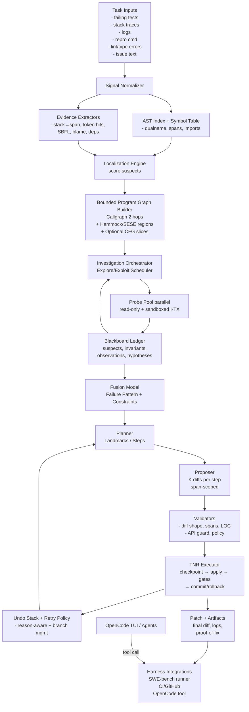

# coding-in-parallel

A transactional, graph-guided diagnosis + repair engine for code and beyond-code tasks.

## Overview

This repository is a deterministic, AST-guided bug-fixer with Transactional No-Regression (TNR) semantics. It ships as a Python package with multiple integration points:

- **`cip-core`**: A reusable Python library exposing graph/AST-guided localization, blackboard-based investigation, planning, proposing, validation, and TNR apply/rollback.
- **`cipd`**: A daemon/service (HTTP/JSON-RPC + event stream) for isolation/worktrees, concurrency, and streaming logs.
- **`cip-cli`**: A CLI for direct invocation in harnesses and automation.
- **OpenCode integration**: Tool server + agent config to use coding-in-parallel from OpenCode's TUI.

## Target Use Cases

1. **SWE-bench / SWE-bench Verified patching** (primary benchmark target)
2. **General repair tasks** beyond tests:
   - Lint/type errors
   - Build failures
   - Runtime crashes from repro scripts
   - Doc generation / broken examples
   - Dependency / API drift fixes
3. **Daily-driver TUI workflow** using OpenCode as your cockpit (navigation, chat, sessions, file browsing, git)

---

## High-Level Architecture

### Core Principles

- **Statistical localization** gives a bounded initial search region.
- **Graph expansion** (callgraph/CFG/hammock regions) creates a structured frontier.
- **Explore/exploit probes** gather evidence in parallel into a shared **Blackboard**.
- **Transactional No-Regression (TNR)** applies fixes as reversible micro-transactions.
- **Undo-and-retry** is a first-class mechanism, aligned with IBM's "undo button for agents" framing and STRATUS-style rollback orchestration.

### System Diagram



---

## OpenCode Integration

The integration strategy is: **Build a Python library + CLI as the source of truth, then integrate into OpenCode via a tool protocol (MCP-style) or "external tool" invocation**. OpenCode becomes the **front-end TUI + orchestration shell** while this engine remains **deterministic + transactional**.

### Why This Approach?

- **You live in Python** — no TypeScript rewrites
- **Clean SWE-bench integration** — direct CLI invocation
- **Daily-driver TUI** — OpenCode handles navigation, chat, sessions, git
- **Reuse OpenCode's agentic workflow layer** — without reimplementing core logic

### Integration Points

#### A) Python CLI (benchmark + automation)

```bash
# Solve a task (SWE-bench compatible)
coding-in-parallel solve --repo <path> --task <instance.json> --out patch.diff

# Run diagnosis only
coding-in-parallel diagnose --repo <path> --task <instance.json> --out diagnosis.json

# Replay a transaction for debugging
coding-in-parallel replay --run <run_id> --txn <k>

# Check environment/tool sanity
coding-in-parallel doctor
```

**Current CLI (v0)**  
The current implementation is a single entrypoint (no subcommands yet). It can also emit a SWE‑bench predictions JSONL file:

```bash
coding-in-parallel \
  --repo <path> \
  --task <instance.json> \
  --out patch.diff \
  --test-cmd "pytest -q" \
  --predictions-out preds.jsonl \
  --model-name "gpt-5"
```

#### B) Python API (for embedding)

```python
from coding_in_parallel import solve

result = solve(repo_path="./my-repo", task=task_instance, mode="swebench")
print(result.patch)
```

#### C) Tool Server (for OpenCode)

```bash
# Start the tool server
coding-in-parallel serve --transport stdio|http
```

Exposes:
- `diagnose` — run localization and return suspects
- `solve` — full end-to-end repair
- `apply_patch` — apply a generated patch
- `explain_run` — explain what happened in a run

#### D) OpenCode Tool + Agent Config

Add a tool definition that calls the server/CLI, and configure a specialized subagent:

```yaml
# OpenCode agent config example
name: GraphFix
system_prompt: |
  Prefer calling the graphfix tool for code repair tasks.
  Do not directly edit files unless the tool fails.
tools:
  - graphfix
permissions:
  - read
  - graphfix
```

This matches OpenCode's agent/subagent model: agents are configured entities with tool access.

### TUI vs Harness Usage

| Context | Integration |
|---------|-------------|
| **TUI (daily driver)** | Slash command `/graphfix` triggers tool in OpenCode |
| **Headless harness** | Call `coding-in-parallel solve` CLI directly |
| **CI/GitHub** | Use CLI in workflow, or OpenCode GitHub automation mode |

---

## SWE-bench Harness Strategy

### Recommended Path

Use the **official SWE-bench evaluation workflow** and plug in the CLI as the "patch generator":

1. Checkout the repo commit
2. Generate a patch: `coding-in-parallel solve --instance instance.json --repo path --out patch.diff`
3. Apply the patch
4. Run tests

This keeps benchmarking stable and reproducible without depending on OpenCode's headless execution contract.

### Docker Runtime for Patch Generation (SWE-bench)

For SWE-bench, **patch generation should execute tests inside the SWE-bench Docker image** (same environment as evaluation).
The agent stays Python-native on the host, but all test execution (baseline, probes, gates) runs inside the container.

Configure the runtime in `config.yaml` (or pass a separate config via `--config`):

```yaml
runtime:
  kind: "docker"
  image: "swebench/swe-bench:latest"
  workdir: "/repo"
  env:
    PYTHONUNBUFFERED: "1"
  user: "host"
```

If your task JSON provides a per-instance image (recommended), include it as:

```json
{
  "instance_id": "...",
  "docker_image": "swebench/swe-bench:latest",
  "metadata": {
    "docker_image": "swebench/swe-bench:latest"
  }
}
```

The CLI will prefer `docker_image` from the task JSON over the config value.

**Note:** OpenCode MCP usage does not require Docker — this is only for SWE-bench-compatible patch generation.

### Can OpenCode Be "The Harness"?

OpenCode supports GitHub workflow execution via `/opencode` comments in CI runners, which is closer to automation than SWE-bench-native integration. For benchmarking:

- **Best stability**: Direct CLI into SWE-bench
- **Daily driving**: OpenCode TUI with tool integration
- **Optional**: Run OpenCode as a baseline agent in separate experiments

---

## Localization Architecture: EoG-Inspired Explore-and-Judge

The localization subsystem uses an **Explanations-over-Graphs (EoG)** inspired architecture that decomposes fault localization into structured phases with bounded LLM reasoning.

### Why Not Traditional ReAct?

Standard ReAct (Reason + Act) agents have fundamental failure modes when applied to code investigation:

| Problem | ReAct Approach | Graph Guided Approach |
|---------|---------------|----------------------|
| **Context Overflow** | Agent accumulates observations in context window until it overflows or loses focus | Context Contract bounds each LLM call to K-hop subgraph; evidence accumulates in ledger, not context |
| **Brittle Tool Use** | LLM picks tools, constructs queries, fills slots — error-prone | Controller handles all I/O deterministically; LLM only receives read-only context packets |
| **Hallucinated Locations** | LLM may invent file paths or line numbers | All locations resolved via AST index; only real code entities are surfaced |
| **No Causal Structure** | Flat list of observations; no propagation reasoning | Builds causal graph G_S with origin/symptom/propagation labels |
| **Non-Deterministic** | Same input → different investigation paths | Controller is deterministic; LLM is constrained to structured judgments |
| **Safety Hazards** | LLM can issue arbitrary commands | LLM never calls tools; only emits structured JSON judgments |
| **No Audit Trail** | Hard to trace why agent reached a conclusion | Ledger records every judgment with rationale; reproducible |

### Architecture Overview

```
┌─────────────────────────────────────────────────────────────────────────────┐
│                     LOCALIZATION AGENT (LangGraph)                           │
├─────────────────────────────────────────────────────────────────────────────┤
│                                                                              │
│  ┌────────────────────────────────────────────────────────────────────────┐ │
│  │ CONTROLLER (Deterministic)                                             │ │
│  │ • Manages Evidence Ledger (L, P, G_S, frontier, labels)                │ │
│  │ • Executes all I/O via Context Contract                                │ │
│  │ • Reconciles evidence after each Judge output                          │ │
│  │ • Never reasons; only bookkeeps                                        │ │
│  └────────────────────────────────────────────────────────────────────────┘ │
│                                     │                                        │
│                                     ▼                                        │
│  ┌────────────────────────────────────────────────────────────────────────┐ │
│  │ LLM JUDGE (Bounded Reasoning)                                          │ │
│  │ • Receives fixed-scope context packets                                 │ │
│  │ • Emits structured judgments: L(v), P(u→v), rationale                  │ │
│  │ • Can request probes (targeted tests)                                  │ │
│  │ • Never calls tools; never sees unbounded context                      │ │
│  └────────────────────────────────────────────────────────────────────────┘ │
│                                     │                                        │
│                                     ▼                                        │
│  ┌────────────────────────────────────────────────────────────────────────┐ │
│  │ CONTEXT CONTRACT (CxC)                                                 │ │
│  │ • Guarantees bounded context for every Judge call                      │ │
│  │ • BASELINE: K-hop subgraph + all initial signals                       │ │
│  │ • CLASSIFY: Per-node CFG + callers/callees + coverage                  │ │
│  └────────────────────────────────────────────────────────────────────────┘ │
│                                                                              │
│  Investigation Flow:                                                         │
│  START ──▶ BASELINE ──▶ SELECT ──▶ CLASSIFY ──▶ RECONCILE ──▶ PROPOSE ──▶   │
│                              ▲                                    │          │
│                              └────────────────────────────────────┘          │
│                                                                              │
└─────────────────────────────────────────────────────────────────────────────┘
```

### Two-Phase Investigation

**Phase 1: BASELINE** — Understand the problem space
- Parse stack traces → extract (file, line) frames
- Build K-hop call subgraph from failing tests
- Seed suspects from stack hits, token matches, heuristics
- Gather package structure, git blame, type info
- LLM creates Investigation Summary with hypotheses

**Phase 2: EXPLORE-AND-JUDGE** — Iterative investigation
- SELECT: Pick next node from queue
- CLASSIFY: LLM analyzes bounded context, emits L(v)/P(u→v) judgment
- RECONCILE: Controller updates ledger, computes frontier
- PROPOSE: LLM suggests next nodes or requests probes
- Loop until coverage satisfied or budget exhausted

### Key Advantages

1. **Bounded Context**: Each LLM call sees at most K-hop subgraph + targeted observability. No context overflow regardless of investigation length.

2. **Code-Grounded**: Every location is resolved via AST index. Suspects have real qualnames, spans, and evidence.

3. **Causal Reasoning**: Builds directed graph G_S with propagation edges. Distinguishes root causes from symptoms.

4. **Probes for Evidence**: Judge can request targeted tests to gather more information. Investigation is interactive, not one-shot.

5. **Deterministic Controller**: All I/O and state updates are deterministic. Same evidence → same labels.

6. **Audit Trail**: Ledger records every judgment with rationale. Investigation is reproducible and explainable.

7. **Reason Propagation**: Every suspect carries reasons that flow to remediation. Fixer knows *why* each location is suspected.

---

## Hammock Blocks (Edit Regions)

A "**hammock**" in program analysis is a **single-entry single-exit (SESE) region** in a control-flow graph (CFG). Hammocks provide edit scopes that are "behavioral units":

- **Edit scopes**: Natural boundaries for patch proposals
- **Probe instrumentation**: "Instrument only this region"
- **Validation enforcement**: "Edits must remain within hammock X"
- **Summarization**: "Describe behavior of region"
- **Patch templates**: "Rewrite region while preserving entry/exit semantics"

### Implementation Stages

**Stage A (fast, high ROI): AST-structured blocks**
- Use AST nodes as pseudo-regions: function body, `if`/`for`/`while` bodies, `try/except` blocks
- Single-entry in practice, maps cleanly to source spans
- Gets 80% of "region editing" without CFG engineering

**Stage B (CFG-lite): Basic CFG per function**
- Build CFG edges for statements, branches, loops
- SESE detection for common patterns: if-else diamonds, try-except-finally, early-return blocks

**Stage C (true SESE): Dominance-based SESE detection**
- Compute dominators/post-dominators in CFG
- Region (u,v) is SESE if u dominates all nodes and v post-dominates all nodes
- Uses `networkx` for dominator algorithms

---

## Diagnosis Pipeline (Formal Spec)

### Candidate Discovery Output Contract

Suspects are defined as:

```
s_i = (m_i, q_i, [ℓ_start, ℓ_end], φ_i)
```

- `m_i`: module/file path
- `q_i`: qualified symbol name (module.class.func)
- `[ℓ_start, ℓ_end]`: span lines
- `φ_i`: feature vector for scoring (stack hits, token hits, SBFL, etc.)

### Scoring Model

Features:
- `f_stack(s) ∈ {0,1,2,...}`: count of stack frames mapping into this symbol
- `f_token(s) ∈ ℝ≥0`: BM25/regex hit score from assertion text
- `f_sbfl(s) ∈ [0,1]`: Ochiai (if coverage is available)
- `f_prior(s) ∈ [0,1]`: priors (recent edits, test-module proximity)
- `f_dist(s) ∈ [0,1]`: graph-distance penalty from primary stack symbol

Score:
```
score(s) = w₁·σ(f_stack) + w₂·σ(f_token) + w₃·f_sbfl + w₄·f_prior - w₅·f_dist
```

Keep top K unique symbols (K ≈ 5–12).

### Callgraph Expansion

Given seed set S₀, expand up to h hops:
```
S_{t+1} = S_t ∪ { neighbors(s) : s ∈ S_t }, t < h
```

Bound by max nodes N (e.g., 40) and keep highest scoring nodes if overflow.

---

## TNR + Undo-and-Retry

### Transaction Contract

A transaction is:
```
τ = (state_pre, Δ, gates, state_post, verdict)
```

Verdict ∈ {commit, rollback}

### Gates (Generalized Beyond Tests)

A "task" defines a gate suite:
- **Static gates**: compile, typecheck (mypy/pyright), lint (ruff), format
- **Behavior gates**: targeted tests, repro script, golden output, benchmark metric
- **Regression gates**: "must not worsen" metrics (µ churn proxy or task-specific)

### Undo Stack

The system maintains:
- `CheckpointManager`: git checkpoint/worktree snapshot
- `UndoStack`: sequence of reversible committed transactions
- `RetryPolicy`: when to resample proposals vs replan vs expand suspects

---

## Current Implementation Snapshot

- **Orchestrator**: `controller.py` runs localize → investigate → combine/plan → propose → validate → TNR. Entry via CLI `coding-in-parallel` (`main.py`).
- **Data/model layer**: `types.py` for spans, candidates, plans, diffs, and transactions. `types_localize.py` for suspects and evidence.
- **AST index**: `ast_index.py` parses Python files, records spans and call sites, supports qualnames, reverse edges, and K-hop subgraph building.
- **Localization**: `localize.py` seeds suspects from stack traces, token matches, and heuristics. `trace_parser.py` extracts frames from pytest output. `token_search.py` finds error strings in source.
- **Investigations**: `investigator.py` with a blackboard, sandboxed probe runner (`probes/runner.py`), scheduler stub (`probes/scheduler.py`), and a simple UCB-like queue.
- **Sandbox/rollback**: `probes/sandbox.py` applies probe patches in temp dirs and always rolls back.
- **Combiner/Planner**: `combine.py` and `planner.py` produce failure patterns and landmarks via strict JSON prompts.
- **Proposer/Validators**: `proposer.py` generates K unified diffs per step; `validate.py` enforces shape, file allowlist, line windows, LOC caps, and API guard.
- **Transactional execution**: `tnr.py` + `vcs.py` checkpoint, apply, gate (static + targeted tests), µ guard, commit/rollback per candidate.
- **Logging/artifacts**: `logging.py` writes `.agent_runs/<id>/events.ndjson` plus artifacts.
- **LLM integration**: `llm.py` shim and optional OpenAI client gated by `CIP_USE_OPENAI=1`.
- **Config/test harness**: `config.py`, `config.yaml` defaults, `pytest` suite covering modules end-to-end.

---

## Gaps vs. Target Design

### Localization Agent Gaps
- No LangGraph agent implementing BASELINE → CLASSIFY → RECONCILE → PROPOSE loop.
- No CFG builder for per-function control flow.
- No probe execution for targeted test writing during investigation.
- No Evidence Ledger with L/P/frontier/labels formalism.
- Scoring is basic (hardcoded weights); no SBFL/Ochiai.

### Core/Library Gaps (cip-core)
- Public API surface: No `api.py` exposing `localize`, `investigate`, `plan`, `propose`, `transact`, `fix` with determinism controls.
- Evidence/blackboard formalism: Blackboard lacks explicit `(L, P_fwd, P_bwd, frontier, labels, coverage)` ledger with SCC contraction and monotone demotion.
- Validators: API guard is basic. No block/hammock slicing for tighter edit windows.

### TNR and Safety Gaps
- Bounded actions per transaction are present but not enforced as a public contract.
- µ guard exists but is simplistic; no discounting whitespace or weighting by file count.
- No replay API for transactions; no provenance tying evidence to commits.

### Service/Daemon Gaps (cipd)
- No HTTP/JSON-RPC server; no SSE/NDJSON event stream endpoint.
- No endpoints for `/v1/localize`, `/investigate`, `/plan`, `/propose`, `/txn`, `/fix`.
- No worktree/container isolation ownership.

### CLI/TUI/OpenCode Gaps
- CLI only calls `controller.run_controller` directly; no dual mode (`direct|daemon`).
- No OpenCode plugin commands or tool bindings.
- No tool server for MCP-style integration.

---

## Implementation Roadmap

### Phase 1 (1–2 days): Benchmark-Ready Core

- [ ] Add `qualname` indexing (module.class.func) to `ast_index`
- [ ] Implement candidate discovery from: failing tests nodeids, stack traces, token hits
- [ ] Add callgraph expansion (1–2 hops) from existing call-site map
- [ ] Produce `SuspectNode[] + slices[] + allowlist` deterministically
- [ ] Implement `coding-in-parallel solve` CLI with SWE-bench instance json contract

### Phase 2 (2–5 days): Investigations + Explore/Exploit

- [ ] Probe registry + sandbox pool (parallel execution)
- [ ] Blackboard v2: versioned ledger + invariants extraction
- [ ] UCB scheduling with budgets + probe gain definitions
- [ ] Fusion: failure pattern JSON contract (LLM optional)

### Phase 3: OpenCode Integration (TUI Daily Driver)

- [ ] `coding-in-parallel serve` tool server (stdio + http transport)
- [ ] OpenCode tool wrapper + "GraphFix agent" config
- [ ] Slash command `/graphfix` (TUI) that triggers tool
- [ ] Document tool protocol and agent configuration

### Phase 4: Hammock Regions (Pragmatic Staged Rollout)

- [ ] Stage A: AST block regions (fast)
- [ ] Stage B: Basic CFG per function
- [ ] Stage C: CFG + SESE dominance (true hammocks)

### Phase 5: LangGraph Agent

- [ ] Add `langgraph` dependency
- [ ] Create `agents/localization.py` with state machine
- [ ] Implement BASELINE, SELECT, CLASSIFY, RECONCILE, PROPOSE nodes
- [ ] Evidence Ledger with L, P, G_S, frontier, labels
- [ ] Probe execution during investigation

---

## Development Quickstart

```bash
uv venv
uv pip install -e .[test]
uv run pytest
uv run coding-in-parallel --help
```

If you don’t use `uv`, fall back to:

```bash
python -m venv .venv
source .venv/bin/activate
pip install -e .[test]
pytest
coding-in-parallel --help
```

Example config:

```bash
cp config.example.yaml config.yaml
```

LLM client (optional):

```python
import coding_in_parallel as cip
cip.llm.set_client(...)
```

Environment variables:
- `CIP_USE_OPENAI=1` — enable OpenAI client
- `OPENAI_API_KEY` — required when OpenAI client is enabled
- `OPENAI_MODEL` — optional model override (default is `gpt-5`)

Smoke test:

```bash
pytest tests/test_e2e_smoke.py
```

Probes and sandboxing:
- By default, probes run in an isolated sandbox. If the repo is a clean git checkout, probes use a **git worktree** for fast isolation; otherwise it falls back to a temp copy.
- Probes execute `test_cmd`, so the repo’s dependencies must be installed in the environment where the agent runs (local or container).

---

## References

- [OpenCode TUI](https://opencode.ai/docs/tui/) — Terminal-first coding agent experience
- [OpenCode Agents](https://opencode.ai/docs/agents/) — Custom prompts, models, and tool access
- [OpenCode CLI](https://opencode.ai/docs/cli/) — CLI utilities for agent management
- [OpenCode GitHub](https://opencode.ai/docs/github/) — GitHub automation mode
- [IBM Undo-and-Retry](https://research.ibm.com/blog/undo-agent-for-cloud) — Undo mechanism for agents

---

License: see `LICENSE`.
